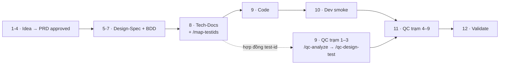

[← Installation](installation.md) · [Getting Started](../README.md)

# Quick Start — Feature đầu tiên end-to-end

> Golden path: từ ý tưởng tới code có test & trace. Mỗi bước có trang chi tiết trong [Pipeline Steps](../02-concepts/pipeline-steps/).

Giả định đã [cài đặt](installation.md) và điền `CLAUDE.md` + `domain-knowledge/`.

---

## Golden path (12 bước)

| # | Lệnh | Output | Ghi chú |
|---|------|--------|---------|
| 1 | `/define-product` | `product-definition/*.md` | Q&A 8 chặng, PO chốt từng chặng |
| 2 | `/generate-prd` | PRD draft | Thuần ngôn ngữ nghiệp vụ |
| 3 | `/refine-prd` | PRD refined | 3 lăng kính DEV/SA/PO → PO accept findings |
| 4 | `/review-context <PRD>` | findings P0–P5 | 🔒 sạch critical → PO đặt `Status: approved` |
| 5 | `/generate-design-spec` | `design-spec/` | **Chỉ FE/App** — bám Figma |
| 6 | `/generate-bdd` | `bdd/*.feature` | 🛑 UC outline; PRD lớn → sub-agent per-UC |
| 7 | `/review-context <feature>` | findings B1–B6 | Sạch critical → `@trace.status: approved` |
| 8 | `/generate-tech-docs` → `/map-testids {TICKET-ID}` → `/review-tech-docs` | `tech-docs/*.md` + §4.5.6 Test Selectors | Lead BE chạy với BDD `system/`, FE chạy với BDD `web/`·`app/` của mình — **song song**, cùng một doc. SA review + cổng ký T7 (lead FE duyệt riêng phần client: `/review-tech-docs {doc} web`). `/map-testids` **chốt hợp đồng test-id TRƯỚC code** |
| 9 | `/generate-code` ∥ `/qc-analyze` → `/qc-plan` → `/qc-design-test` | code + `.trace/*.tsv` ∥ `*.Test.md` | 🛑 comprehension checkpoint + build verify. **FE và QC chạy song song** trên cùng hợp đồng §4.5.6 — cửa vào làn QC là `/qc-analyze`; ba trạm đầu không cần code |
| 10 | `/dev-gen-test` → `/dev-run-test` | dev smoke | Set `dev_selftest` |
| 11 | `/qc-review-testcase` … `/qc-run-script` ∥ `/qc-run-manualtest` → `/qc-report {TICKET-ID}` | QC report + evidence | Từ trạm 6 `/qc-design-script` mới cần code chạy được. Set `qc_status` (Playwright · WebdriverIO + Appium) |
| 12 | `/validate-traces` | coverage matrix | spec ↔ code ↔ test |

---

## Sửa spec hiện hữu (Drift handling)

Khi PO sửa `.feature`/PRD (bump version):

1. `/generate-code <feature>` — so `spec ↔ .trace/*.tsv`.
2. Phân loại OK / DRIFT / UNTRACKED.
3. 🛑 Comprehension checkpoint — *"{N} SC drifted/new. Proceed?"*.
4. Regen phần lệch → cập nhật `.tsv`.

---

## Bug fix

`/fix-bug {TICKET}` → đọc bug spec-anchored → tạo branch `fix/{TICKET}-<slug>` → root cause → sửa (tag `@trace.fixes`) → regression test + build verify → commit sau khi duyệt.

---

## Nếu AI ra output sai (Troubleshooting)

95% nguyên nhân ở **context**:

| Triệu chứng | Kiểm tra |
|-------------|----------|
| Sinh code sai entity field | Entity catalog có load + filter đúng domain? |
| Sai naming/convention | `CLAUDE.md` (root+overlay) có ở cuối context? |
| Bỏ qua rule X | Rule X có trong `required[]`? |
| Sinh sai stack (umbrella) | Service overlay `CLAUDE.md` được nạp? |
| Output khác nhau mỗi lần | Có tool ad-hoc đọc file? Phải qua context-loader |

---

## Đọc tiếp (Next)

- Hiểu từng bước sâu hơn → [Pipeline Steps](../02-concepts/pipeline-steps/)
- Theo vai trò của bạn → [Guides](../03-guides/)
- Tra cứu lệnh → [Reference › Commands](../04-reference/commands.md)
