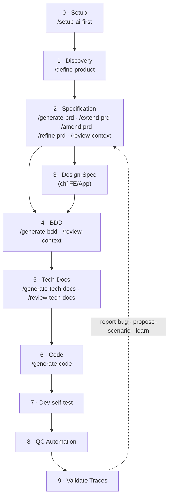

[← Docs Home](../README.md) · [Concepts](./) · [Glossary →](glossary.md)

# Overview — Mô hình toàn trình (Big Picture)

> Bức tranh lớn của framework: pipeline một chiều, gate hai đầu, và feedback ngược có kiểm soát. Muốn đào sâu từng bước → [Pipeline Steps](pipeline-steps/).

---

## Sơ đồ toàn trình (End-to-end Flow)



---

## Ba đặc tính bất biến (Invariants)

1. **Pipeline một chiều** — output giai đoạn N là input N+1. Không nhảy bước.
2. **Gate hai đầu** mỗi giai đoạn — gate đầu vào (validate) + gate đầu ra (findings/approval).
3. **Feedback ngược không tạo loop** — bug/scenario/lesson cải tiến spec & tri thức, rồi pipeline lại chảy một chiều.

---

## HITL: dày ở thượng nguồn, mỏng ở hạ nguồn

**Rule vàng:** AI có thể sai ở bất kỳ đâu, nhưng sai ở **thượng nguồn** (PRD/BDD) nhân lên **cấp số nhân** ở hạ nguồn (code/test). Nên checkpoint **dày** ở spec/design, **mỏng dần** xuống code.

| Giai đoạn | HITL | Checkpoint chính |
|-----------|:----:|------------------|
| Discovery | 🔴 cao nhất | Chốt từng chặng Q&A |
| Specification | 🔴 cao | `/review-context` sạch critical + PO approve |
| Design-Spec / BDD | 🔴 cao | UC decomposition, findings |
| Tech-Docs | 🟠 vừa | Review đa chiều + ký T7 |
| Code | 🟡 mỏng | Comprehension checkpoint |
| Dev-test / QC | 🟡–🟠 | Cổng review test |

→ Chi tiết: [Roles & HITL](roles-and-hitl.md).

---

## Bốn "ngăn altitude" (không lộn tầng)

Mọi tài liệu **trước** Tech-Docs nói bằng **ngôn ngữ nghiệp vụ** (Business Language Guard giữ ranh giới):

| Ngăn | Là gì | Ví dụ |
|------|-------|-------|
| **AC** | Nghiệm thu (outcome) | "Người dùng đăng nhập được sau khi đặt lại mật khẩu" |
| **BR / BL** | Cơ chế nghiệp vụ | "Link reset hết hạn sau 15 phút" |
| **Scope** | Ranh giới | "Không hỗ trợ khôi phục qua SMS" |
| **Dictionary** | Định nghĩa | "Link reset = one-time token gửi qua email" |

Chi tiết kỹ thuật (retry/timeout/API/selector) chỉ xuất hiện từ **Tech-Docs** trở đi.

---

## Ba lớp kiến trúc (3-layer)

```
Command (orchestrator)  →  điều phối các phase của workflow
   ├── Skill            →  domain logic, stateless, chỉ consume context
   └── Step             →  infra tái dùng (context-loader, gate, spawn-agent…)
```

Đổi pipeline không đụng skill; đổi skill không đụng infra. → [Architecture](architecture.md).

---

## Đa domain & Umbrella (Multi-domain)

- Mọi artifact theo bố cục **feature-package**: `specs/{domain}/{prd-slug}/…`.
- **Umbrella**: nhiều service submodule + một **spec repo dùng chung** (`spec_source`) chứa PRD/BDD/tech-docs/design-spec/`.trace`/`feedback`/findings. `/sync` đồng bộ.
- `CLAUDE.md` phân tầng: root (luật chung) + `{service}/CLAUDE.md` (kiến trúc + coding standards theo stack).

---

## Đọc tiếp (Next)

- [Glossary](glossary.md) — thuật ngữ
- [Roles & HITL](roles-and-hitl.md) — ma trận vai trò
- [Traceability](traceability.md) — trace & drift
- [Pipeline Steps](pipeline-steps/) — chi tiết từng bước
