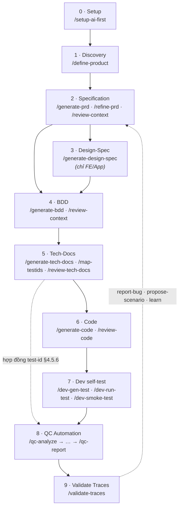

[← Concepts](../) · [← Docs Home](../../)

# ⭐ Pipeline Steps — Chi tiết từng bước (Step-by-step Reference)

Đây là phần **lõi** của tài liệu Concepts. Mỗi trang mô tả **một bước** trong pipeline theo cùng một khuôn: bạn đưa gì vào, nhận gì ra, ai làm gì, framework xử lý ra sao, và điểm dừng của con người (HITL) nằm ở đâu.

> Nếu bạn chỉ muốn nắm bức tranh lớn trước → đọc [Overview](../overview.md).
> Nếu bạn muốn biết **vai trò của mình** đi qua những bước nào → đọc [Guides theo vai trò](../../03-guides/).

---

## Bản đồ pipeline (Pipeline Map)

**Đặc tính bất biến:** pipeline **một chiều** — output của bước N là input của bước N+1. *(Đường nét đứt 5 → 8 **không** phải nhảy bước: đó là hợp đồng test-id §4.5.6 được chốt ở bước 5 để QC dựng test **song song** với FE, xem [Tech-Docs](05-tech-docs.md).)* Mỗi bước có **gate đầu vào** (validate) và **gate đầu ra** (findings/approval). Kênh feedback ngược (bước 10) **không tạo loop** mà để cải tiến spec và tri thức dự án.

---

## Danh sách các bước (Steps)

| # | Bước | Command chính | Owner | HITL |
|---|------|---------------|-------|:----:|
| 0 | [Setup](00-setup.md) | `/setup-ai-first` | Admin/Lead | ⚪ một lần |
| 1 | [Discovery](01-discovery.md) | `/define-product` | PO | 🔴 cao nhất |
| 2 | [Specification](02-specification.md) | `/generate-prd` · `/refine-prd` · `/review-context` | PO (+SA/Dev review) | 🔴 cao |
| 3 | [Design-Spec](03-design-spec.md) | `/generate-design-spec` | PO/PM | 🟠 vừa *(chỉ FE/App)* |
| 4 | [BDD](04-bdd.md) | `/generate-bdd` · `/review-context` | PO (+Dev) | 🔴 cao |
| 5 | [Tech-Docs](05-tech-docs.md) | `/generate-tech-docs` · `/map-testids` · `/review-tech-docs` | SA/Lead | 🟠 vừa |
| 6 | [Code](06-code.md) | `/generate-code` · `/review-code` · `/fix-bug` | Dev | 🟡 mỏng |
| 7 | [Dev self-test](07-dev-selftest.md) | `/dev-gen-test` · `/dev-run-test` · `/dev-smoke-test` | Dev | 🟡 mỏng |
| 8 | [QC Automation](08-qc-automation.md) | `/qc-analyze` … `/qc-report` | QA/Tester | 🟠 vừa |
| 9 | [Validate Traces](09-validate-traces.md) | `/validate-traces` | Dev/QA/Lead | ⚪ read-only |
| 10 | [Feedback Loop](10-feedback-loop.md) | `/report-bug` · `/propose-scenario` · `/learn` · `/sync` | Tester/tất cả | ⚪ |

> **HITL dày ở thượng nguồn, mỏng ở hạ nguồn** — vì sai ở PRD/BDD **nhân lên theo cấp số nhân** xuống code/test. Xem [Roles & HITL](../roles-and-hitl.md).

---

## Cách đọc mỗi trang (Page template)

Mọi trang bước dùng chung các mục sau:

| Mục | Trả lời câu hỏi |
|-----|-----------------|
| **Tóm tắt** | Bước này là gì trong một câu? Command nào? |
| **Mục đích** (Purpose) | Tại sao bước này tồn tại? Bỏ nó thì mất gì? |
| **Input** (Đầu vào) | Cần có gì trước khi chạy? |
| **Output** (Đầu ra) | Chạy xong sinh ra file/trạng thái gì? |
| **Ai làm gì** (Roles) | Con người và AI mỗi bên đảm nhận phần nào? |
| **Câu hỏi cần trả lời** | Bước này giúp đội trả lời những câu hỏi nào? |
| **Framework xử lý thế nào** (Mechanics) | Bên trong AI làm những gì? |
| **HITL / Gate** | Con người dừng ở đâu, duyệt cái gì? |
| **Anti-pattern** | Lỗi thường gặp cần tránh. |
| **Bước tiếp theo** | Đi đâu sau khi xong. |

---

## Khung chung mọi command (Common Gate)

Trước khi chạy phần logic riêng, **mọi** `/command` đều đi qua một **Gate** giống nhau. Hiểu Gate này một lần, bạn hiểu 90% "phần đầu" của mọi lệnh — các trang bước sẽ **không lặp lại** phần này:

| Bước Gate | Làm gì | Ý nghĩa với người dùng |
|-----------|--------|------------------------|
| **0 · Sub-agent mode** | Nếu lệnh được gọi bởi orchestrator (payload JSON `_agent_mode`), bỏ qua phần hỏi-đáp và chạy đúng phạm vi được giao | Bạn không thấy trực tiếp — đây là cơ chế fan-out per-UC |
| **0-B · Model check** | Khuyến nghị dùng model **Opus**. `Y` = đang dùng · `S` = bỏ qua (chấp nhận rủi ro) · khác = dừng | Checkpoint **mềm** — bảo vệ chất lượng suy luận |
| **1 · Target file** | Xác định file mục tiêu từ `$ARGUMENTS` (path / UC-ID / ticket), hoặc liệt kê cho bạn chọn | Bạn có thể gọi lệnh không cần path — AI tự dò theo bố cục `specs/{domain}/{prd-slug}/…` |
| **2 · Context loader** | Nạp context (rules, project-context, CLAUDE.md, entity, spec…) theo thứ tự tối ưu | "Thủ thư" chọn đúng-đủ-gọn context. Xem [Architecture](../architecture.md) |
| **3 · CHECKPOINT** | Trình bày: target, phạm vi, file sẽ tạo/sửa → chờ bạn `Y` | Điểm dừng đầu tiên trước khi AI làm việc thật |

> Các lệnh **read-only** (`/review-code`, `/validate-traces`, `/debug`) bỏ qua checkpoint ghi-file.

---

## Ký hiệu (Legend)

- 🔴 HITL cao · 🟠 vừa · 🟡 mỏng · ⚪ không/đọc-thôi
- 🛑 = checkpoint bắt buộc dừng · 🔒 = gate trạng thái (chặn downstream tới khi `approved`)
- 🤖 = AI thực thi · 👤 = con người quyết định
