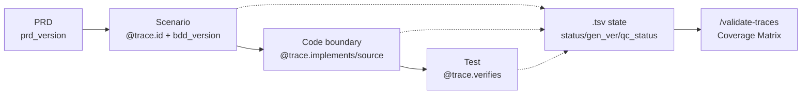

[← Roles & HITL](roles-and-hitl.md) · [Concepts](./) · [Architecture →](architecture.md)

# Traceability — Truy vết đầu-cuối (End-to-end Trace)

> Từ scenario nhìn xuống biết code nào hiện thực; từ code nhìn lên biết scenario nào yêu cầu. Đây là một trong ba "trái tim" của framework.

---

## Trace tags theo artifact

| Artifact | Trace tag |
|----------|-----------|
| **BDD file** (header) | `@trace.id` · **`@trace.platform`** · **`@trace.service`** · `@trace.module` · `@trace.domain` · `@trace.prd` · `@trace.prd_version` · `@trace.bdd_version` · `@trace.status` · `@trace.dataset` |
| **BDD scenario** (mỗi SC) | `@trace.scenario` · **`@trace.sc_version`** · `@trace.business_rules` |
| **Code** (boundary only) | `@trace.implements` · `@trace.source` · **`@trace.prd_version` · `@trace.bdd_version` · `@trace.tech_doc_revision`** · **`@trace.design_spec_version`** *(chỉ FE/App)* — lặp cả block theo **từng UC** trong file đa-UC |
| **Code** (chỗ chưa implement) | `@trace.stub` · `@trace.stub_owner` · `@trace.stub_for` · `@trace.seam_pending` · `@trace.seam_port` |
| **Test** | `@trace.verifies` |
| **Bug fix** | `@trace.fixes` · `@trace.root_cause` · `@trace.regression` |

→ Đầy đủ field & format: [Reference › Trace Schema](../04-reference/trace-schema.md).

---

## Boundary-only tagging

Chỉ tag `@trace` ở **boundary**, không tag mọi file → tránh **tag explosion**:

| ✅ Tag | ❌ Không tag |
|--------|-------------|
| Controller / Handler / Middleware / Steps file | Entity / Repository / DTO / Interface / Base class |

> Shared code (entity, repo) được dò qua **import chain** từ boundary — không cần tag riêng.

---

## Trace state — file `.tsv`

`.trace/{domain}/{prd-slug}/{UC-ID}-{platform}.tsv` — mỗi UC × platform một sổ. Trong umbrella, nằm ở **spec repo dùng chung** (một nơi authoritative để PM/PO quản lý).

| Cột | Chủ sở hữu | Ý nghĩa |
|-----|-----------|---------|
| `status` | `/generate-code`, `/validate-traces` | OK / GAP / DRIFT / UNTRACKED |
| `implemented_by` | `/generate-code` | File code hiện thực SC |
| `dev_selftest` | `/dev-run-test` | Smoke của **dev** |
| `qc_status` | `/qc-run-script` + `/qc-run-manualtest`, `/report-bug`, **`/map-testids`** | Trạng thái QC **chính thức** (Playwright). `/map-testids` **chỉ hạ về `not_run`**, không bao giờ ghi giá trị khẳng định — xem ô "Làm mất hiệu lực" dưới |
| `bdd_version` / `spec_ver` | spec | Version để phát hiện drift |
| `service` *(cột 23)* | `/generate-bdd` | Đội/submodule sở hữu SC — nguồn của `by_service` trên dashboard |
| `design_spec_version` *(cột 24)* | `/generate-bdd` | Version design-spec lúc sinh BDD *(FE/App; `—` cho backend)* |

**24 cột.** TSV cũ thiếu cột mới → đọc thành giá trị rỗng, **không báo lỗi**; header tự nâng ở lần `/generate-bdd` gen lại kế tiếp. Đọc theo **tên cột ở header row**, không theo vị trí.

> **Làm mất hiệu lực ≠ ghi đè.** Chủ sở hữu là người **duy nhất** ghi giá trị **khẳng định** (`pass`/`fail`/số lượng). Nhưng lệnh nào làm giá trị đó **hết đúng** (spec đổi, code đổi) **bắt buộc** hạ nó về `not_run`/`—`. Giữ một `pass` sinh ra từ spec đã bị sửa là **báo cáo sai**, không phải tôn trọng quyền sở hữu cột. Ví dụ mới nhất: `/map-testids` ghi lại §4.5.6 → mọi test-script bám selector cũ đã hết đúng → lệnh hạ `qc_status` về `not_run` và `qc_run_at` về `—`. Ngoại lệ có chủ ý: `qc_owner`/`qc_blocked_by` (con trỏ bug vẫn còn giá trị) và `test_count`/`test_classes` (test vẫn trên đĩa — **cảnh báo**, không hạ số, để tỷ lệ coverage không nhảy loạn).
| `gen_ver` | `/generate-code` | Version lúc sinh code (so với `spec_ver`) |
| `test_count` | test | Số test phủ SC |
| `last_updated` | nhiều | Mốc cập nhật |

> **`dev_selftest` ≠ `qc_status`.** Dev smoke (nhanh, tự kiểm) và QC chính thức (Playwright, evidence) là **hai trục độc lập** — không lấn quyền nhau.

---

## Phân loại coverage (Coverage Status)

`/validate-traces` phân loại mỗi SC theo **thứ tự ưu tiên** (rule sớm thắng):

| # | Trạng thái | Điều kiện | Hành động |
|---|-----------|-----------|-----------|
| 1 | **UNTRACKED** | `gen_ver == —` | Chưa sinh code → `/generate-code` |
| 2 | **DRIFT** | có code **và** `spec_ver != gen_ver` | Spec đổi → **regen trước khi test** |
| 3 | **GAP** | có code **và** `test_count == — / 0` | Có code, chưa test → bù test |
| 4 | **OK** | version khớp, có code, có test | Đủ phủ |

> **DRIFT xét trước GAP:** SC có code + chưa test + spec vừa drift phải hiện `DRIFT` (không phải `GAP`) — vì `/generate-code` xử GAP = "skip codegen" còn DRIFT = "regenerate". Nếu GAP thắng, code lỗi thời bị bỏ qua.

---

## Version sống ở đâu — và vì sao code CŨNG mang version

**Spec là SSOT của "version hiện tại". Code mang version của "lúc tôi được sinh ra".** Hai thứ khác nhau, nên không phải dual SSOT.

| Nơi | Ghi cái gì | Ai ghi |
|---|---|---|
| `.feature` / PRD / tech-doc | version **hiện tại** của spec — SSOT | tác giả spec |
| `.tsv` `spec_ver` | gương của `@trace.sc_version` hiện tại | `/generate-bdd`, `/validate-traces` |
| `.tsv` `gen_ver` | version scenario **tại thời điểm codegen**, theo từng SC | `/generate-code` |
| **Code** `@trace.prd_version` · `@trace.bdd_version` · `@trace.tech_doc_revision` · `@trace.design_spec_version` | version của **từng artifact upstream** tại thời điểm codegen, theo từng **method** | `/generate-code` |

Drift = **so các mốc này với nhau**; sự lệch nhau chính là tín hiệu, không phải lỗi dữ liệu:

- `spec_ver != gen_ver` → `DRIFT` (scenario đổi sau khi sinh code)
- `@trace.prd_version` trong code < Version PRD hiện tại → `PRD_DRIFT`
- `@trace.bdd_version` trong code < `.feature` hiện tại → `BDD_DRIFT`
- `@trace.tech_doc_revision` trong code < `@trace.revision` của tech-doc → `TECHDOC_DRIFT`
- `@trace.design_spec_version` trong code FE < Version design-spec → `DESIGNSPEC_DRIFT`

> **Lệch version KHÔNG luôn là drift.** PRD và tech-doc là tài liệu **gộp** phủ nhiều UC nhưng chỉ có **một** số version. Thêm UC7 làm mọi UC cũ lệch số dù không đổi một chữ. Nên `/validate-traces` **lọc theo `{changelog_scope}` của row changelog**: UC có trong tập bị ảnh hưởng → `PRD_DRIFT` 🟠; không có → `PRD_STALE_REF` ⓘ (chỉ con trỏ cũ, sạch bằng `--realign-prd-version`); row **mơ hồ** → 🟠 cho mọi UC (lưới an toàn).
>
> Dòng changelog là **contract máy đọc** (`changelog_row_contract`), không phải ghi chú cho người đọc: mỗi mệnh đề mở đầu bằng **đơn vị sở hữu** (`{UC-ID}:` hoặc `PRD-global:`), và **BR/AC luôn đi kèm UC sở hữu** — `sửa BR8` trơ trọi nêu đủ ID để **không** bị coi là mơ hồ, nhưng phép thử là *"**UC** này có trong tập?"*, nên UC sở hữu BR8 rơi vào ⓘ trong khi nội dung của nó vừa đổi, và `--realign` dán nhãn lại (GAPS-v4 G53). Consumer vì thế **chuẩn hoá BR/AC về UC sở hữu** trước khi so. `self-check` **R12** canh cả bốn producer.

> **Và một điểm mù mà so-version KHÔNG bắt được: sửa tay.** Mọi cờ ở trên so **nhãn**, không so **nội dung** — không có content hash nào trong framework. PRD bị sửa mà `Version` không đổi ⇒ **0 cờ**. `/validate-traces` **Step 3.9** bịt bằng cờ 🔴 `PRD_UNTRACKED_EDIT`: so `git diff` **và** `git status` với mốc `spec_baseline` của lần audit trước. Cửa chính để đổi một yêu cầu đã duyệt là **`/amend-prd`**.

**Vì sao không thể bỏ tag version trong code và chỉ dựa vào `.tsv`:**

1. **Độ phân giải khác nhau.** `.tsv` là một sổ cho mỗi UC × platform. Một **file code** có thể phục vụ nhiều UC, mỗi UC ở một version khác nhau — chỉ tag đặt cạnh từng method mới diễn đạt được "UC1 ở bdd v1.4, UC3 ở v2.1".
2. **Vòng đời khác nhau.** `.tsv` là artifact **sinh ra**, có thể regen/xoá/mirror; ở chế độ umbrella nó còn nằm ở **repo khác** (spec submodule) với code. Tag trong code là bản ghi duy nhất **đi cùng** code qua mọi lần copy/move/merge.
3. **Sự lệch nhau là thứ ta muốn đo.** Nếu chỉ có một bản ghi thì không có gì để so — đó mới là lúc drift trở nên không phát hiện được.

> ⚠️ **Đừng "tối ưu" bằng cách gỡ tag version khỏi code.** `/validate-traces` Step 4/5/5c **đọc chính các tag đó**; gỡ đi là làm drift detection mù **im lặng** — build vẫn xanh, dashboard vẫn đẹp. `/review-code` lăng kính 1 gắn cờ **major** cho mỗi block `@trace.implements` thiếu tag version đi kèm.

---

## Luồng truy vết (Trace Flow)



---

## Sổ trace trong git — và khi nó conflict

Sổ trace là **dữ liệu không dựng lại được**, nằm trong git, và **được nhiều người ghi trên
nhiều nhánh song song**. Ba thứ đó cộng lại nghĩa là git phải được dạy cách merge nó.

### Luật đã cài sẵn

`/setup-ai-first` tạo `{trace_dir}/.gitattributes`; `/sync` Step 4c kiểm và tạo hộ nếu thiếu:

```gitattributes
*.tsv    text eol=lf merge=union
*.jsonl  text eol=lf merge=union
```

| Luật | Không có nó thì sao |
|---|---|
| `merge=union` | Hai nhánh cùng ghi một sổ → **conflict**. Giải bằng "take mine" = **mất row của người kia, im lặng**. Với `trace-history.jsonl` (append cuối file) thì **mọi** cặp nhánh song song đều conflict. |
| `text eol=lf` | Một máy ghi CRLF → git thấy **mọi dòng** đã đổi → union giữ cả hai bản → **nhân đôi cả file**, gồm cả dòng header. Team mixed Windows/macOS gặp ca này mà không ai làm gì sai. |

`union` là driver **built-in** của git — không ai cần chạy `git config` gì thêm.

> **`*.json` cố ý KHÔNG có trong danh sách.** `trace-report.json` nằm cùng thư mục và union
> trên JSON tạo ra **JSON không hợp lệ** → panel VS Code parse lỗi. Nó **sinh lại được**:
> conflict ở đó thì chạy lại `/validate-traces`, đừng merge tay.

### Đánh đổi có chủ ý: trùng row thay vì mất row

`merge=union` **có thể** tạo hai row cùng `sc_id`. Đó là **thiết kế**, không phải lỗi:

```
trùng row  →  --lint-trace T4 bắt được  →  /validate-traces reconcile  →  sạch
mất  row  →  KHÔNG có gì bắt được       →  phát hiện sau 3 tuần        →  khôi phục bằng tay
```

Đây là lý do luật merge và `--lint-trace` là **một cặp**: union chuyển lỗi từ dạng *im lặng*
sang dạng *bắt được*, và cái bắt nó phải tồn tại. Có union mà không có lint thì chỉ là đổi chỗ lỗi.

### Playbook — 4 bước

Vẫn thấy conflict trong `{trace_dir}/` (nhánh phân kỳ quá xa, hoặc luật vừa mới được thêm):

1. **GIỮ CẢ HAI BÊN.** Xoá ba dòng marker (`<<<<<<<`, `=======`, `>>>>>>>`), giữ toàn bộ row
   của cả hai phía. **Đừng chọn một bên.**
2. `npx @educa-corp/sdd-framework --lint-trace` — T7 xác nhận không còn marker, T4 chỉ ra row nào trùng.
3. `/validate-traces` — reconcile row trùng về một row đúng, tính lại `status`.
4. Commit.

**Ba điều không bao giờ làm:**

| ❌ | Vì sao |
|---|---|
| `git checkout --ours/--theirs` trên file trace | Xoá sạch row của một phía. Không có gì báo. |
| Xoá file trace để "cho sạch" rồi chạy lại pipeline | Sổ **không regenerate được** — `trace-history.jsonl` mất là mất vĩnh viễn. |
| Commit khi còn marker | Marker thành một "row" TSV. `--lint-trace` T7 bắt, nhưng nếu chưa cắm vào CI thì nó vào nhánh chung. |

---

## Đọc tiếp (Next)

- [Architecture](architecture.md) — 3 lớp & context-loader
- [Pipeline › Validate Traces](pipeline-steps/09-validate-traces.md) — dùng ma trận coverage
- [Reference › Trace Schema](../04-reference/trace-schema.md) — field đầy đủ
