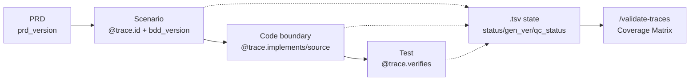

[← Roles & HITL](roles-and-hitl.md) · [Concepts](./) · [Architecture →](architecture.md)

# Traceability — Truy vết đầu-cuối (End-to-end Trace)

> Từ scenario nhìn xuống biết code nào hiện thực; từ code nhìn lên biết scenario nào yêu cầu. Đây là một trong ba "trái tim" của framework.

---

## Trace tags theo artifact

| Artifact | Trace tag |
|----------|-----------|
| **BDD scenario** | `@trace.id` · `@trace.scenario` · `@trace.business_rules` · `@trace.bdd_version` · `@trace.prd_version` |
| **Code** (boundary only) | `@trace.implements` · `@trace.source` — *KHÔNG lưu version* (tránh dual SSOT) |
| **Test** | `@trace.verifies` · `@trace.covers` |
| **Bug fix** | `@trace.fixes` · `@trace.root_cause` · `@trace.regression` |

→ Đầy đủ field & format: [Reference › Trace Schema](../04-reference/trace-schema.md).

---

## Boundary-only tagging

Chỉ tag `@trace` ở **boundary**, không tag mọi file → tránh **tag explosion**:

| ✅ Tag | ❌ Không tag |
|--------|-------------|
| Controller / Handler / Middleware / Steps file | Entity / Repository / DTO / Interface / Base class |

> Shared code (entity, repo) được dò qua **import chain** từ boundary — không cần tag riêng.

---

## Trace state — file `.tsv`

`.trace/{domain}/{prd-slug}/{UC-ID}-{platform}.tsv` — mỗi UC × platform một sổ. Trong umbrella, nằm ở **spec repo dùng chung** (một nơi authoritative để PM/PO quản lý).

| Cột | Chủ sở hữu | Ý nghĩa |
|-----|-----------|---------|
| `status` | `/generate-code`, `/validate-traces` | OK / GAP / DRIFT / UNTRACKED |
| `implemented_by` | `/generate-code` | File code hiện thực SC |
| `dev_selftest` | `/dev-run-test` | Smoke của **dev** |
| `qc_status` | `/qc-run-test`, `/report-bug` | Trạng thái QC **chính thức** (Playwright) |
| `bdd_version` / `spec_ver` | spec | Version để phát hiện drift |
| `gen_ver` | `/generate-code` | Version lúc sinh code (so với `spec_ver`) |
| `test_count` | test | Số test phủ SC |
| `last_updated` | nhiều | Mốc cập nhật |

> **`dev_selftest` ≠ `qc_status`.** Dev smoke (nhanh, tự kiểm) và QC chính thức (Playwright, evidence) là **hai trục độc lập** — không lấn quyền nhau.

---

## Phân loại coverage (Coverage Status)

`/validate-traces` phân loại mỗi SC theo **thứ tự ưu tiên** (rule sớm thắng):

| # | Trạng thái | Điều kiện | Hành động |
|---|-----------|-----------|-----------|
| 1 | **UNTRACKED** | `gen_ver == —` | Chưa sinh code → `/generate-code` |
| 2 | **DRIFT** | có code **và** `spec_ver != gen_ver` | Spec đổi → **regen trước khi test** |
| 3 | **GAP** | có code **và** `test_count == — / 0` | Có code, chưa test → bù test |
| 4 | **OK** | version khớp, có code, có test | Đủ phủ |

> **DRIFT xét trước GAP:** SC có code + chưa test + spec vừa drift phải hiện `DRIFT` (không phải `GAP`) — vì `/generate-code` xử GAP = "skip codegen" còn DRIFT = "regenerate". Nếu GAP thắng, code lỗi thời bị bỏ qua.

---

## Single SSOT cho version

- **Version chỉ ở spec level** (`bdd_version`/`prd_version`). Code **không** lưu version riêng — nó dùng `.tsv` (`gen_ver`) để so.
- Lưu version cả spec lẫn code = **dual SSOT** → drift không đáng tin.

---

## Luồng truy vết (Trace Flow)

---

## Đọc tiếp (Next)

- [Architecture](architecture.md) — 3 lớp & context-loader
- [Pipeline › Validate Traces](pipeline-steps/09-validate-traces.md) — dùng ma trận coverage
- [Reference › Trace Schema](../04-reference/trace-schema.md) — field đầy đủ
