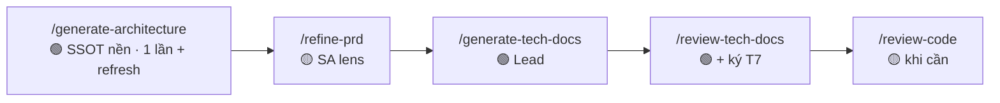

[← Docs Home](../README.md) · [Guides](./)

# Guide · Architect / SA

> Bạn **sở hữu bức tranh kiến trúc** (`architecture.md`), **quyết trade-off thiết kế** và **chốt contract giữa các team**. Vai trò nặng ở **Kiến trúc nền** + **Tech-Docs**, cộng lăng kính SA khi review PRD.

---

## Chuỗi bước của bạn (Your path)



`/generate-architecture` là **bước nền một-lần** (rồi refresh khi kiến trúc đổi) — nằm ngoài vòng lặp per-feature, nhưng là thứ mọi tech-design về sau bám vào.

---

## Kiến trúc nền — `architecture.md` (bạn sở hữu)

`architecture.md` là **nguồn chân lý (SSOT) kiến trúc cắt ngang** toàn hệ thống. `/generate-tech-docs` nạp nó để tech-design bám đúng kiến trúc thật, thay vì mỗi feature tự suy một kiểu.

**Bạn KHÔNG điền tay 140 ô.** Chạy `/generate-architecture` — lệnh tự lo phần nặng, bạn chỉ **verify**:

1. **Tự hút cái đã biết** — đọc `project-context.yaml` + `CLAUDE.md`, tài liệu có sẵn (`--from=docs/**/*.md`), và scan code (brownfield). Điền sẵn tối đa.
2. **Chỉ hỏi cái chưa biết** — phỏng vấn bằng **câu dễ hiểu** (có ví dụ, Có/Không), và **bỏ qua** mọi câu đã có đáp án từ bước 1. Nếu còn mơ hồ, nó **đào sâu** đúng chỗ đó tới khi đủ để viết — bạn luôn gõ được *"để sau"* để hoãn.
3. **Bạn verify** — mở file, sửa chỗ AI đoán sai (đối chiếu `<!-- nguồn -->`), rồi đổi `verified_by: AI-draft` → **tên bạn**. Chỉ khi đó doc mới thành **ràng buộc kiến trúc chính thức**; còn `AI-draft` thì tech-docs vẫn dùng nhưng gắn ⚠️.

**Phân tầng (tier) — điền có ưu tiên, khỏi ngộp:**

| Tier | Nghĩa | AI nạp khi sinh code? |
|------|-------|----------------------|
| **core** | Nền mọi feature cần (Tech Stack · Tầng · Đặt tên · API · DB) | ✅ |
| **conditional** | Chỉ khi hệ thống có (Multi-tenant, Event Bus, Sharding, Auth…) | ✅ nếu bật; nếu không → để **STUB** |
| **ops** | Vận hành, chỉ người đọc (Observability, Deploy, NFR…) | ❌ (không làm nhiễu context) |

**Điền dần & làm mới:**
- `/generate-architecture --section=multi-tenant` — lấp/refresh **đúng một mục** đang STUB, không phải làm lại cả file.
- `/generate-architecture --from=<paths>` — nạp thêm tài liệu có sẵn để hút nội dung.
- Chạy lại bất cứ lúc nào để **refresh**; nếu file đã verify, lệnh chỉ đề xuất **drift** (không đè bản bạn đã duyệt).
- **Umbrella:** kiến trúc là code-level → chạy `/generate-architecture {service-path}` cho từng service.

---

## Việc của bạn ở mỗi bước

| Bước | Bạn làm gì |
|------|-----------|
| Kiến trúc nền | `/generate-architecture` → **verify** `architecture.md` (đổi `verified_by` thành tên bạn). Refresh khi kiến trúc đổi |
| Review PRD | Lăng kính **SA** trong `/refine-prd` — đọc PRD bằng **mắt kiến trúc** nhưng viết lại bằng **lời nghiệp vụ** (rủi ro, phụ thuộc, nhất quán hệ thống) |
| [Tech-Docs](../02-concepts/pipeline-steps/05-tech-docs.md) | Lead `/generate-tech-docs` — chuẩn hoá entity/API/dependency; **reverse-document** khi API đã tồn tại. Nó tự nạp `architecture.md` (core+conditional) |
| Review Tech-Docs | `/review-tech-docs` đa chiều; **ký cổng liên team T7** cho contract cross-service |
| Code | `/review-code` khi cần soát kiến trúc |

---

## Nguyên tắc sống còn cho SA

1. **`architecture.md` là SSOT kiến trúc** — bạn sở hữu và **verify** nó. `AI-draft` chưa verify chỉ là gợi ý; đổi `verified_by` = tên bạn để nó thành ràng buộc chính thức.
2. **Tech-design LÀ API contract** — BE viết, FE/App đọc ở `/generate-code --phase=integration`. Chốt sai = đốt budget cả hai phía.
3. **Một tech-design gộp full-stack cho cả PRD** (không per-UC/per-platform); §10 UC Coverage ánh xạ finding về từng UC.
4. **Reverse-document khi API tồn tại** — mô tả as-is, không "tự chế" shape mới.
5. **Ký T7 trước khi code** — contract cross-service phải được các team liên quan xác nhận.
6. **Entity catalog là nguồn chân lý** — dùng nó khi sinh tech-docs để nhất quán với PRD/BDD.
7. Với dependency cross-service → cân nhắc sinh **System BDD**.

---

## Câu hỏi bạn cần trả lời được

- Kiến trúc cắt ngang (tầng, multi-tenant, nguồn dữ liệu, auth) đã được ghi & verify trong `architecture.md` chưa?
- Mỗi UC hiện thực bằng API/endpoint/DTO nào?
- Entity/field/quan hệ/enum chuẩn là gì?
- Contract BE↔FE có khớp & đủ cho mọi scenario không?
- Dependency cross-service nào cần System BDD + ký T7?
- Có trade-off kiến trúc nào PO/Dev chưa thấy?

---

## Anti-pattern

- ❌ Để `architecture.md` mãi ở `verified_by: AI-draft` — tech-docs sẽ kế thừa giả định chưa ai xác nhận.
- ❌ Điền tay cả template từ giấy trắng thay vì để `/generate-architecture` hút từ config/tài liệu/code.
- ❌ Tự chế shape DTO/endpoint khi API đã tồn tại.
- ❌ Bỏ cổng ký T7 → hai team hiểu contract khác nhau, rework tốn kém.
- ❌ Đưa chi tiết kỹ thuật vào PRD khi review (SA lens viết bằng lời nghiệp vụ).

---

## Cắm vào CI — cái gì chặn được bằng máy

Đây là việc của SA/Lead, không phải của dev từng người: **kỷ luật nào không chặn thì sau
sprint thứ ba không ai làm.** Framework có hai lệnh CLI trả exit code — cắm được vào pipeline:

| Lệnh | Chặn gì | Đặt ở đâu |
|---|---|---|
| `--lint-trace` | **Cấu trúc sổ** (12 rule): header lệch · row sai số ô · enum sai · `sc_id` trùng · marker conflict git · `.jsonl` hỏng. Cộng **T12 — nhất quán GIỮA các ô**: row vừa `status ∈ {DRIFT, ORPHANED}` vừa mang `dev_selftest`/`qc_status = pass`. Cộng hai điều kiện **cấu hình** ở mức ⚠️: thiếu luật merge · sổ bị gitignore | pre-push **và** CI |
| `--gate-trace` | **Cấu hình** (nâng hai ⚠️ trên thành chặn) + **cờ 🔴**: `ORPHANED` · `TRACE_ORPHAN` · `SEAM_UNWIRED` · `STUB_UNRESOLVED` | CI (cần report tươi) |

```bash
npx @educa-corp/sdd-framework --lint-trace     # exit 1 nếu sổ hỏng
npx @educa-corp/sdd-framework --gate-trace     # exit 1 nếu có cờ 🔴
```

Mẫu sẵn dùng: `.agent/templates/ci/trace-gate.yml` (GitHub Actions) · `.agent/templates/hooks/pre-push`.
**Copy ra khỏi `.agent/`** trước khi dùng — mọi thứ trong đó bị ghi đè mỗi lần `/update-framework`.

### Bốn tầng của `--gate-trace`, và vì sao thứ tự đó

0. **Sổ được bảo vệ?** — sổ có **nằm trong git**? git có **biết cách gộp** sổ? Kiểm cấu trúc của một quyển sổ sắp mất thì vô nghĩa. Hai điều kiện này `lint-trace` đã phát hiện dưới dạng ⚠️; gate **nâng** chúng thành lỗi chặn — *pre-push nhắc, CI chặn*.
1. **Sổ đúng hình dạng?** (gọi `--lint-trace`) — phán trạng thái trên sổ lệch cột là phán trên dữ liệu rác.
2. **Report còn tươi VÀ phủ toàn bộ?** — đối chiếu `trace-report.json` với chính sổ TSV nó khai
   là đang mô tả. Không có tầng này thì cổng là **sân khấu**: chạy `/validate-traces` một lần,
   commit report, rồi sửa gì cũng được — CI đọc report cũ và cho qua mãi.
   **Cộng thêm (G57):** report mang field `scope`, và G2 **fail** nếu `scope.kind !== "all"` —
   **không ngoại lệ**, không đếm xem trên đĩa có bao nhiêu domain. `/validate-traces --domain/--prd/--uc`
   là audit **một phần**; muốn tạo PR thì phải có một lần audit **toàn bộ** đã commit.
   *(Report sinh trước G57 không có `scope` → gate ⚠️ "kiểm độ phủ ở mức YẾU", không fail.)*
3. **Có cờ 🔴?** — đếm counter, nêu tên thủ phạm kèm câu `fix` của chính framework.

### Giới hạn — nói rõ với team, đừng để họ tin quá

> **Hai thứ `--lint-trace` bắt được mà không cần LLM** *(nên cứ để nó chạy ở CI)*:
> **T12** — `status = DRIFT` mà `dev_selftest = pass` là một sổ **hợp lệ** với 11 rule cũ (T1–T8
> chỉ kiểm hình dạng *từng ô*), nhưng nó là một lời khẳng định **sai**. T12 là rule đầu tiên nhìn
> **nhiều ô cùng lúc**. **T10/T11** — luật merge + gitignore, gate nâng thành chặn.
>
> `--gate-trace` chứng minh **"report khớp SỔ"**.
> Chỉ `/validate-traces` chứng minh được **"sổ khớp CODE"** (nó phải quét tag trong source,
> đọc `.feature`, so version — việc của LLM).

Nên cổng bắt được ca phổ biến *"quên chạy lại `/validate-traces`"*, nhưng **không** bắt được
*"sửa code mà không đụng sổ"*. Cổng in ra đúng giới hạn này mỗi lần chạy, kể cả khi xanh.

Đường bịt: job **`require-fresh-audit`** trong template — **bật mặc định**. Nó hỏi
*"PR có chạm dòng nào mang một trong 7 tag mà report đang khẳng định không?"*
(`@trace.implements` · `verifies` · `seam_port` · `seam_pending` · `stub` · `stub_owner` ·
`stub_for` — nguồn của đúng 4 cờ 🔴). Có mà không kèm `trace-report.json` mới → **chặn**.

| PR làm gì | Kết quả |
|---|:---:|
| Sửa log trong Controller · thêm field vào DTO · đổi query Repository | ✅ cho qua |
| Thêm/xoá method mang `@trace.implements` · lấp một `@trace.stub` | 🔴 chặn |

> **Không dùng `^src/`** — framework có luật *boundary-only tagging*: Entity/Repository/DTO/
> Interface **không** mang tag, nên `^src/` chặn cả PR chỉ thêm một field vào DTO. Báo oan ⇒
> cổng bị tắt ⇒ mất luôn phần thật sự cần chặn. `self-check` **R10** fail build nếu file CI
> thiếu một tag — thiếu thì `grep` không khớp gì và job **luôn xanh**.
>
> **Giới hạn:** đổi tên class không chạm dòng tag ⇒ bỏ lọt. Ca đó ít gặp và **không im lặng**
> (`/validate-traces` lần sau báo ngay). Biến thể chặt hơn ghi trong comment của template.

### Cờ 🟠 cố ý KHÔNG chặn

`PRD_DRIFT` · `BDD_DRIFT` · `TECHDOC_DRIFT` · `DESIGNSPEC_DRIFT` là **nợ** — "code chưa theo
kịp spec" — không phải code hỏng. Chặn PR vì nợ làm cổng đỏ liên tục, và cổng đỏ liên tục sẽ
bị tắt, mất luôn cả phần 🔴. `bin/self-check.js` **R9** fail build nếu ai nhét một cờ 🟠 vào
danh sách chặn.

---

## Lệnh của bạn (Your commands)

`/generate-architecture` · `/generate-tech-docs` · `/review-tech-docs` · `/refine-prd` (SA lens) · `/review-code` · `/generate-spec-manifest`

→ [Bảng lệnh đầy đủ](../04-reference/commands.md) · [Architecture](../02-concepts/architecture.md)
