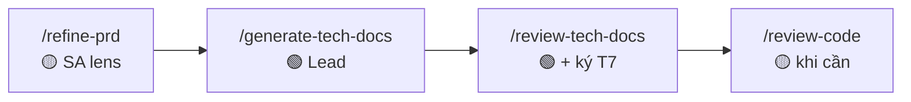

[← Docs Home](../README.md) · [Guides](./)

# Guide · Architect / SA

> Bạn **quyết trade-off thiết kế** và **chốt contract giữa các team**. Vai trò nặng ở **Tech-Docs**, cộng lăng kính SA khi review PRD.

---

## Chuỗi bước của bạn (Your path)

---

## Việc của bạn ở mỗi bước

| Bước | Bạn làm gì |
|------|-----------|
| Review PRD | Lăng kính **SA** trong `/refine-prd` — đọc PRD bằng **mắt kiến trúc** nhưng viết lại bằng **lời nghiệp vụ** (rủi ro, phụ thuộc, nhất quán hệ thống) |
| [Tech-Docs](../02-concepts/pipeline-steps/05-tech-docs.md) | Lead `/generate-tech-docs` — chuẩn hoá entity/API/dependency; **reverse-document** khi API đã tồn tại |
| Review Tech-Docs | `/review-tech-docs` đa chiều; **ký cổng liên team T7** cho contract cross-service |
| Code | `/review-code` khi cần soát kiến trúc |

---

## Nguyên tắc sống còn cho SA

1. **Tech-design LÀ API contract** — BE viết, FE/App đọc ở `/generate-code --phase=integration`. Chốt sai = đốt budget cả hai phía.
2. **Một tech-design gộp full-stack cho cả PRD** (không per-UC/per-platform); §10 UC Coverage ánh xạ finding về từng UC.
3. **Reverse-document khi API tồn tại** — mô tả as-is, không "tự chế" shape mới.
4. **Ký T7 trước khi code** — contract cross-service phải được các team liên quan xác nhận.
5. **Entity catalog là nguồn chân lý** — dùng nó khi sinh tech-docs để nhất quán với PRD/BDD.
6. Với dependency cross-service → cân nhắc sinh **System BDD**.

---

## Câu hỏi bạn cần trả lời được

- Mỗi UC hiện thực bằng API/endpoint/DTO nào?
- Entity/field/quan hệ/enum chuẩn là gì?
- Contract BE↔FE có khớp & đủ cho mọi scenario không?
- Dependency cross-service nào cần System BDD + ký T7?
- Có trade-off kiến trúc nào PO/Dev chưa thấy?

---

## Anti-pattern

- ❌ Tự chế shape DTO/endpoint khi API đã tồn tại.
- ❌ Bỏ cổng ký T7 → hai team hiểu contract khác nhau, rework tốn kém.
- ❌ Đưa chi tiết kỹ thuật vào PRD khi review (SA lens viết bằng lời nghiệp vụ).

---

## Lệnh của bạn (Your commands)

`/generate-tech-docs` · `/review-tech-docs` · `/refine-prd` (SA lens) · `/review-code` · `/generate-spec-manifest`

→ [Bảng lệnh đầy đủ](../04-reference/commands.md) · [Architecture](../02-concepts/architecture.md)
