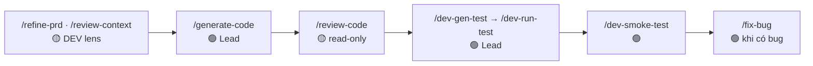

[← Docs Home](../README.md) · [Guides](./)

# Guide · Developer (FE / BE / App)

> Bạn **nhận spec đã duyệt và sinh code từ nó**. Code là *hệ quả của spec*, không phải nguồn. Vai trò của bạn nặng ở **hạ nguồn** (Code → Dev-test) + review lăng kính DEV ở thượng nguồn.

---

## Chuỗi bước của bạn (Your path)

---

## Việc của bạn ở mỗi bước

| Bước | Bạn làm gì |
|------|-----------|
| Review upstream | Lăng kính **DEV** trong `/refine-prd` — bắt chỗ mơ hồ khó hiện thực |
| [Code](../02-concepts/pipeline-steps/06-code.md) | Chạy `/generate-code`; xác nhận **comprehension checkpoint** (drift new/drifted/synced); đảm bảo build pass |
| Review code | `/review-code` (read-only) — soát kỹ, **không auto-fix** |
| [Dev self-test](../02-concepts/pipeline-steps/07-dev-selftest.md) | `/dev-gen-test` → `/dev-run-test` (set `dev_selftest`) → `/dev-smoke-test` |
| [Bug fix](../02-concepts/pipeline-steps/10-feedback-loop.md) | `/fix-bug` — root cause → sửa → regression test |

---

## Nguyên tắc sống còn cho Dev

1. **Không sinh code cho file không có `.feature` backing** (ngoài fix-bug/debug).
2. **Boundary-only tagging** — tag `@trace.implements` ở controller/handler, không tag entity/repo.
3. **Scope Lock** — chỉ implement UC target; code UC khác trong file dùng chung là **bất khả xâm phạm**. Đọc `@trace.implements` để bảo toàn, đừng xoá.
4. **Version chỉ ở spec** — code không lưu version; drift dò qua `.tsv`.
5. **Build phải pass** trước commit (`{conventions.build_command}`, ≤3 retry).
6. `CLAUDE.md` (§2 layer/package, §3 coding standards, §5 error handling) là nguồn — AI *follow*, bạn giữ nó cập nhật.

---

## Frontend: hai phase

| Phase | Khi nào | Việc |
|-------|---------|------|
| `--phase=ui` | BE contract chưa sẵn | Sinh UI + layer **mock API** từ System BDD |
| `--phase=integration` | BE contract `approved` | Nối vào contract thật (đọc tech-design từ spec repo) |

---

## Câu hỏi bạn cần trả lời được

- SC nào **mới / drifted / synced** so với lần sinh trước?
- Code theo **layer/package/convention** nào của stack này?
- Contract (DTO/endpoint/error) lấy từ đâu — tech-design §4 hay System BDD?
- Build pass chưa? Smoke pass chưa?

---

## Anti-pattern

- ❌ Tag `@trace` mọi file → tag explosion.
- ❌ Tái tạo file dùng chung "chỉ gồm scenario UC này" → xoá nhầm nghiệp vụ UC khác.
- ❌ Coi `dev_selftest` thay QC chính thức.
- ❌ Để AI tự review code nó vừa sinh.

---

## Lệnh của bạn (Your commands)

`/generate-code` · `/review-code` · `/dev-gen-test` · `/dev-run-test` · `/dev-smoke-test` · `/fix-bug` · `/map-testids` · `/debug`

→ [Bảng lệnh đầy đủ](../04-reference/commands.md) · [Traceability](../02-concepts/traceability.md)
