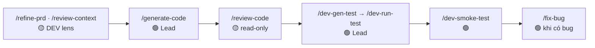

[← Docs Home](../README.md) · [Guides](./)

# Guide · Developer (FE / BE / App)

> Bạn **nhận spec đã duyệt và sinh code từ nó**. Code là *hệ quả của spec*, không phải nguồn. Vai trò của bạn nặng ở **hạ nguồn** (Code → Dev-test) + review lăng kính DEV ở thượng nguồn.

---

## Chuỗi bước của bạn (Your path)



---

## Việc của bạn ở mỗi bước

| Bước | Bạn làm gì |
|------|-----------|
| Review upstream | Lăng kính **DEV** trong `/refine-prd` — bắt chỗ mơ hồ khó hiện thực |
| [Code](../02-concepts/pipeline-steps/06-code.md) | Chạy `/generate-code`; xác nhận **comprehension checkpoint** (drift new/drifted/synced); đảm bảo build pass |
| Review code | `/review-code` (read-only) — soát kỹ, **không auto-fix** |
| [Dev self-test](../02-concepts/pipeline-steps/07-dev-selftest.md) | `/dev-gen-test` → `/dev-run-test` (set `dev_selftest`) → `/dev-smoke-test` |
| [Bug fix](../02-concepts/pipeline-steps/10-feedback-loop.md) | `/fix-bug` — root cause → sửa → regression test |

---

## Nguyên tắc sống còn cho Dev

1. **Không sinh code cho file không có `.feature` backing** (ngoài fix-bug/debug).
2. **Boundary-only tagging** — tag `@trace` ở controller/handler, không tag entity/repo. Nhưng ở boundary thì phải **đủ block 5 tag** (dưới).
3. **Scope Lock** — chỉ implement UC target; code UC khác trong file dùng chung là **bất khả xâm phạm**. Đọc `@trace.implements` để bảo toàn, đừng xoá.
4. **Code CŨNG mang version** — `@trace.prd_version` · `@trace.bdd_version` · `@trace.tech_doc_revision` ghi *"tôi được sinh theo bản nào"*, còn spec giữ *"bản hiện tại"*. Sự **lệch nhau** giữa hai mốc chính là tín hiệu drift. Đừng "tối ưu" bằng cách gỡ chúng — `/validate-traces` đọc đúng các tag đó.
5. **File phủ nhiều UC → lặp cả block theo từng method.** Không gộp header, không trỏ `@trace.source` vào thư mục.
6. **Sửa scenario thì bump `@trace.sc_version`** của chính SC đó — nếu bạn sửa `.feature` bằng tay. Quên bump = code cũ vĩnh viễn hiện `OK`.
7. **Build phải pass** trước commit (`{conventions.build_command}`, ≤3 retry).
8. `CLAUDE.md` (§2 layer/package, §3 coding standards, §5 error handling) là nguồn — AI *follow*, bạn giữ nó cập nhật.

```java
// @trace.implements=AUTH-UC1-SC3
// @trace.prd_version=1.2   @trace.bdd_version=1.4   @trace.tech_doc_revision=3
// @trace.source=specs/auth/login/bdd/system/AUTH-UC1-login.feature
public TokenDto login(...) { }
```

→ Lý do đầy đủ (vì sao **không** phải dual-SSOT): [Traceability](../02-concepts/traceability.md)

---

## Frontend: hai phase, hoặc một lần (full)

| Mode | Khi nào | Việc |
|-------|---------|------|
| `--phase=ui` | BE contract chưa sẵn | Sinh UI + layer **mock API** từ System BDD |
| `--phase=integration` | BE contract `approved`, UI đã có | Nối vào contract thật (đọc tech-design từ spec repo) |
| **không flag** (`fe_full`) | contract sẵn, muốn làm dứt điểm | Sinh UI **+** wire API thật một lần, bỏ lớp mock |

> Cả `integration` lẫn `fe_full` đều qua **DS4** (kiểm §4.5.4 đủ trước khi wire; vét nguồn rồi gộp-hỏi thay vì hỏi live) và **DS5** (thấy component/service FE đang chạy thì **hỏi reuse/new**, không im lặng dựng mới). Bảng hành vi đầy đủ theo từng mode → [Explain · generate-code](../explain/09-generate-code.md#hành-vi-theo-mode-phase--platform).

---

## Câu hỏi bạn cần trả lời được

- SC nào **mới / drifted / synced** so với lần sinh trước?
- Code theo **layer/package/convention** nào của stack này?
- Contract (DTO/endpoint/error) lấy từ đâu — tech-design §4 hay System BDD?
- Build pass chưa? Smoke pass chưa?

---

## Anti-pattern

- ❌ Tag `@trace` mọi file → tag explosion.
- ❌ Tái tạo file dùng chung "chỉ gồm scenario UC này" → xoá nhầm nghiệp vụ UC khác.
- ❌ Gộp tag của nhiều UC về một header file, hoặc trỏ `@trace.source` vào thư mục → drift báo oan hoặc mù; UC rơi về `UNTRACKED` dù đã có code.
- ❌ Gỡ tag version khỏi code cho "gọn" → `/validate-traces` mù, **im lặng**.
- ❌ Coi `dev_selftest` thay QC chính thức.
- ❌ Chạy `/dev-run-test` khi row đang `DRIFT` rồi tin dấu xanh. Từ v0.7.0 lệnh **tự chặn**: test pass trên row `DRIFT` → nó ghi `not_run`, **không** ghi `pass` (`fail` thì vẫn ghi `fail`). Lý do: `pass` nghĩa *"đã nghiệm thu theo spec **hiện tại**"*, và test cũ đang nghiệm thu một hành vi không còn tồn tại. Đường đúng: `/generate-code {UC-ID}` → `/dev-gen-test {UC-ID}` → chạy lại.
- ❌ Để AI tự review code nó vừa sinh.
- ❌ Tạo PR khi `/validate-traces` còn cờ 🔴 (`SEAM_UNWIRED` · `STUB_UNRESOLVED` · `ORPHANED` · `TRACE_ORPHAN`) — build xanh không chứng minh luồng ghép chạy đúng.
- ❌ Coi FE `fe_phase = ui` là xong vì status đã `OK` — test đang chạy trên **mock**.
- ❌ Tự đóng bug mình vừa fix — `/fix-bug` chỉ đặt `🟡 Fixed`; `🟢 Closed` là của `/qc-run-test`.

---

## Lệnh của bạn (Your commands)

`/generate-code` · `/review-code` · `/dev-gen-test` · `/dev-run-test` · `/dev-smoke-test` · `/fix-bug` · `/map-testids` · `/debug`

→ [Bảng lệnh đầy đủ](../04-reference/commands.md) · [Traceability](../02-concepts/traceability.md)
