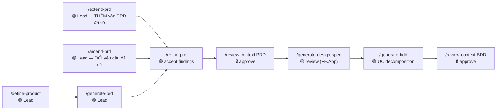

[← Docs Home](../README.md) · [Guides](./)

# Guide · Product Owner / BA

> Bạn **định nghĩa cái gì đáng làm**. Vai trò của bạn nặng nhất ở **thượng nguồn** (Discovery → PRD → BDD) — nơi sai một ly đi một dặm.

---

## Chuỗi bước của bạn (Your path)

Sau khi BDD `approved`, bạn bàn giao xuống Dev/SA — nhưng vẫn nhận **product-gap** từ QC.

### Bốn nhánh chạm PRD — phân biệt bằng THAO TÁC GHI

| Bạn muốn | Lệnh | Ghi kiểu gì |
|---|---|---|
| PRD **chưa có** | `/generate-prd` | **Write** cả file |
| **THÊM** UC/AC/BR mới | `/extend-prd` | Edit **add-only** — output là **superset chặt**, đánh số **nối tiếp** |
| **ĐỔI** một yêu cầu đang đúng cú pháp *("BR8 nói tối đa 5 file, giờ đổi thành 20")* | **`/amend-prd`** | Edit **tại chỗ** — output **KHÔNG** phải superset; bạn khai tường minh ID cần sửa |
| Sửa **vấn đề review chỉ ra** | `/refine-prd` → Review Board → `--resume` | Edit trong phạm vi finding |

**Bỏ hẳn một quy tắc** → `/amend-prd --retire {ID}`: khai tử **tại chỗ**, **giữ nguyên** row + ID. Không có lệnh xoá row, và có chủ ý — xoá làm `@trace.business_rules` trong `.feature` trỏ vào ID không còn ⇒ `TRACE_ORPHAN` 🔴.

> ⚠️ **Đừng sửa tay file `.md`** *(GAPS-v4 G54)*. Mọi cờ drift của framework so **nhãn version**, không so **nội dung** — nên sửa tay mà không bump version là điểm mù **tuyệt đối**: `/validate-traces` thấy version khớp ⇒ sạch · gate thấy report khớp sổ ⇒ PASS · CI thấy PR không chạm code ⇒ không đòi audit. Ba tầng xanh trên một yêu cầu code chưa hề làm theo.
>
> `/validate-traces` Step 3.9 canh cửa sau bằng cờ 🔴 `PRD_UNTRACKED_EDIT` (so `git diff` **và** `git status` với mốc lần audit trước). Đường sửa: bump `Version` + ghi một row changelog nêu UC — tức đúng việc `/amend-prd` làm hộ.

---

## Việc của bạn ở mỗi bước

| Bước | Bạn làm gì | Quyết định |
|------|-----------|------------|
| [Discovery](../02-concepts/pipeline-steps/01-discovery.md) | Trả lời Q&A 8 chặng, **chốt từng chặng** | Vấn đề, user, UC, BR, AC, edge case, scope |
| [Specification](../02-concepts/pipeline-steps/02-specification.md) | Duyệt PRD draft; **accept/reject từng finding** của `/refine-prd`; đặt `Status: approved` | Scope & terminology đúng chưa |
| [Design-Spec](../02-concepts/pipeline-steps/03-design-spec.md) | Review spec visual bám Figma (FE/App) | Visual khớp intent |
| [BDD](../02-concepts/pipeline-steps/04-bdd.md) | Chốt **UC decomposition**; đặt `@trace.status: approved` | Cấu trúc UC/SC đúng |
| [QC](../02-concepts/pipeline-steps/08-qc-automation.md) | Nhận **product-gap**, quyết ưu tiên sửa | Gap nào là lỗi sản phẩm |

---

## Nguyên tắc sống còn cho PO

1. **Viết thuần ngôn ngữ nghiệp vụ** — đừng nhét API/retry/timeout vào PRD/BDD. Business Language Guard sẽ chặn, nhưng bạn nên tự giữ altitude.
2. **Bốn ngăn không lộn**: AC (nghiệm thu) · BR/BL (cơ chế) · Scope (ranh giới) · Dictionary (định nghĩa).
3. **Gate là trạng thái, không phải lệnh** — "duyệt" = bạn tự đặt `| Status | approved |`. Chỉ đặt khi **sạch finding critical**.
4. **Chốt từng chặng, đừng "để AI tự hiểu"** — AI sẽ suy diễn và bạn trả giá ở downstream.
5. Khi bạn sửa cùng một kiểu nhiều lần → gợi ý team `/learn` để ghi lesson.

---

## Câu hỏi bạn cần trả lời được

- Tính năng này giải quyết pain point gì? Cho ai?
- Gồm những UC/BR/AC nào? Edge case nào?
- Cái gì **trong** scope, cái gì **ngoài**?
- Mỗi scenario BDD có phủ đúng một AC/BR không?

---

## Anti-pattern

- ❌ Đặt `approved` khi còn finding critical → phá gate, code rác.
- ❌ Bỏ `/refine-prd` "vì PRD trông ổn".
- ❌ Chạy `/generate-prd` lại trên PRD đã có để "cập nhật" — nó **từ chối chạy** (§Guard: *"Tồn tại → DỪNG. KHÔNG ghi, KHÔNG hỏi Y/N"*), và đúng vậy: ghi đè sẽ mất changelog + đánh số lại BR (phá liên kết ở mọi `.feature` đã sinh). **Thêm** yêu cầu → `/extend-prd`; **đổi** một yêu cầu đã có → `/amend-prd`.
- ❌ Mở file PRD `.md` ra sửa tay — xem cảnh báo G54 ở §Chuỗi bước. Framework **không thấy** thay đổi đó cho tới khi `/validate-traces` Step 3.9 bắt được, và mọi cờ drift ở giữa đều báo sạch.
- ❌ Viết dòng changelog kiểu `"cập nhật theo yêu cầu mới"` — dòng đó là **contract**. Mơ hồ thì `/generate-bdd` gen lại **toàn bộ**, và `/validate-traces` báo động oan cho **mọi** UC thay vì chỉ UC vừa đổi. Luôn nêu **UC/AC/BR bị ảnh hưởng**.
- ❌ Để `feedback/prd-change-requests/` chất đống — đó là yêu cầu thật tester phát hiện từ sản phẩm chạy thật, và **không cờ trace nào bắt được** (chưa có AC thì theo mọi thước đo coverage nó *không tồn tại*). `/validate-traces` nhắc kèm số ngày chờ; xử bằng `/extend-prd`.
- ❌ Nhảy từ ý tưởng thẳng sang yêu cầu Dev code.

---

## Lệnh của bạn (Your commands)

`/define-product` · `/generate-prd` · `/extend-prd` · `/amend-prd` · `/refine-prd` · `/review-context` · `/generate-design-spec` · `/generate-bdd`

→ [Bảng lệnh đầy đủ](../04-reference/commands.md) · [Glossary](../02-concepts/glossary.md)
