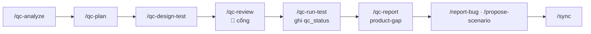

[← Docs Home](../README.md) · [Guides](./)

# Guide · Tester / QA

> Bạn **chạy kiểm thử chính thức** (dây chuyền `/qc-*`, Playwright) và là **kênh feedback** đưa bug/scenario ngược về spec. Bạn ghi `qc_status` — trạng thái QC chính thức, có evidence.

---

## Chuỗi bước của bạn (Your path)

---

## Việc của bạn ở mỗi bước

| Trạm | Bạn làm gì |
|------|-----------|
| [`/qc-analyze`](../02-concepts/pipeline-steps/08-qc-automation.md) | Phân rã yêu cầu + phát hiện **gap tài liệu** |
| `/qc-plan` | Đánh giá rủi ro + câu hỏi cho dev |
| `/qc-design-test` | Thiết kế test case Markdown (`*.Test.md`) |
| `/qc-review` | 🛑 **Cổng review** case & script trước khi chạy |
| `/qc-run-test` | Chạy pytest-playwright, ghi **`qc_status`**; phân loại FAIL |
| `/qc-report` | Report + evidence, đẩy **product-gap** về PO/Dev |
| [Feedback](../02-concepts/pipeline-steps/10-feedback-loop.md) | `/report-bug`, `/propose-scenario` — kênh có hồ sơ spec |

Bạn cũng dùng `/validate-traces` để thấy **gap chưa phủ** (spec ↔ code ↔ test).

---

## Nguyên tắc sống còn cho QA

1. **`qc_status` ≠ `dev_selftest`** — bạn ghi QC chính thức (Playwright, evidence); dev smoke là trục độc lập.
2. **Không bao giờ fake-pass** — FAIL do product-gap thì **giữ FAIL + evidence**, đẩy về PO/Dev. Chỉ sửa script khi là script-bug (selector/logic).
3. **Không chạy test kém** — phải qua cổng `/qc-review` trước `/qc-run-test`.
4. **Bug phải spec-anchored** — `/report-bug` gắn `@trace` tới UC/SC để truy vết & regression.
5. Stack QC cố định: Python + pytest-playwright + Page Object (module `qc-playwright`), **độc lập** module của dev.

---

## Câu hỏi bạn cần trả lời được

- Yêu cầu phân rã thành test case nào? Tài liệu có gap gì?
- Rủi ro nào cao? Cần hỏi dev gì?
- SC nào PASS/FAIL chính thức? FAIL là **script-bug** hay **product-gap**?
- Bug này gắn với scenario/spec nào?
- Scenario nào còn thiếu cần đề xuất (`/propose-scenario`)?

---

## Anti-pattern

- ❌ Sửa script cho "xanh" khi thực chất là product-gap → giấu lỗi sản phẩm.
- ❌ Chạy `/qc-run-test` khi chưa qua `/qc-review`.
- ❌ Lẫn `qc_status` với `dev_selftest`.
- ❌ Bug không gắn spec → khó truy vết, khó regression.

---

## Lệnh của bạn (Your commands)

`/qc-analyze` · `/qc-plan` · `/qc-design-test` · `/qc-review` · `/qc-run-test` · `/qc-report` · `/report-bug` · `/propose-scenario` · `/validate-traces`

→ [Bảng lệnh đầy đủ](../04-reference/commands.md) · [Traceability](../02-concepts/traceability.md)
